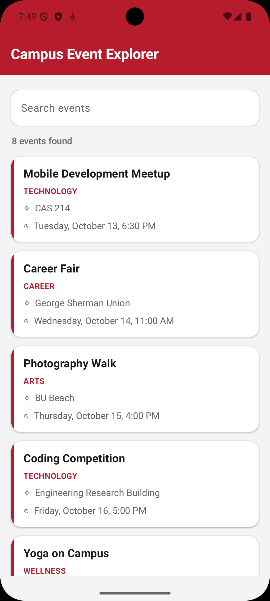
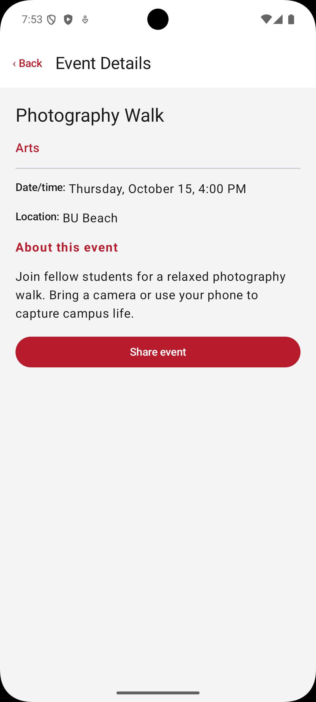
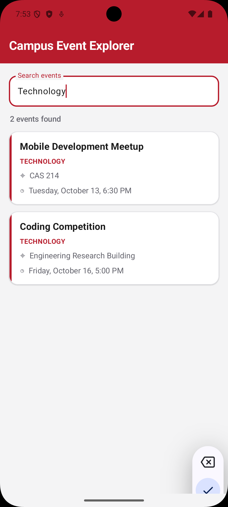
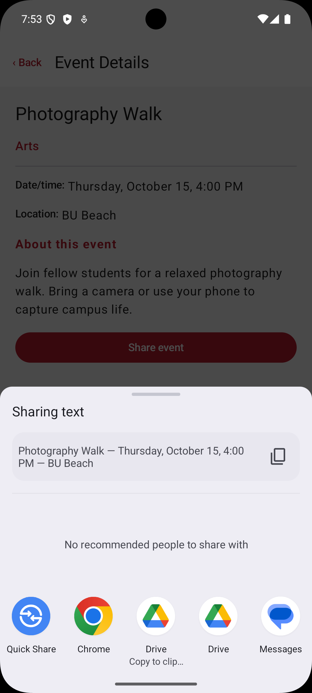

# Campus Event Explorer

## Overview

Campus Event Explorer is an Android application built with Kotlin and Jetpack Compose. It allows users to browse campus events, search by event title or category, view event details, and share event information with other applications.

## Features

- Displays eight sample campus events in a LazyColumn.
- Searches events by title or category as the user types.
- Uses stable event IDs as LazyColumn keys.
- Navigates between the event list and detail screens using type-safe Navigation Compose routes.
- Displays an unavailable-event message for invalid event IDs.
- Shares event information through Android's system share sheet.
- Preserves the search query and navigation state during rotation.

## How it's built

The application uses a `CampusEvent` data class to represent each event. Navigation passes only the event ID rather than the complete event object. The detail destination retrieves the corresponding event from the event collection.

`EventNavigation` owns the search state using `rememberSaveable`. The visible event list is derived from the query rather than stored as a separate mutable list.

The screen composables receive their data and callbacks as parameters. Navigation is handled outside the screen composables, keeping UI code separate from navigation logic.

The Share event action uses an implicit `ACTION_SEND` intent and `Intent.createChooser()` to allow the user to select another application.

## Screenshots

### Event List

The main screen displays the available campus events, including their categories, locations, and times.

### Event Details

Selecting an event opens a detail screen with more information about the event.

### Event Search

Users can search for events by title or category. This example shows the results for a search for "Technology."

### Share Event

Users can share event information using Android's share chooser.

## Technologies

- Kotlin
- Jetpack Compose
- Material 3
- Navigation Compose
- Kotlin Serialization

## Implementation Questions

### 1. Why does the route contain an event ID instead of the complete event object?

The route passes only the event ID because it uniquely identifies the event. The detail screen uses that ID to find the event in the existing collection. This keeps navigation arguments simple and avoids passing the entire object between screens.

### 2. Which composable owns the search state?

`EventNavigation` owns the search state using `rememberSaveable`. It passes the current query and the `onQueryChange` callback to `EventListScreen`.

### 3. Why does the search value use `rememberSaveable`?

`rememberSaveable` preserves the search text when the activity is recreated, such as during a device rotation. This allows the user to return to the list without losing their search.

### 4. What happens to the back stack when an event is selected?

When an event is selected, the app navigates to `EventDetail` with the event ID. The detail destination is placed on top of the event list in the navigation back stack. Pressing system Back or the app-bar Up button returns to the list.

### 5. How does the UI request navigation without directly accessing the NavController?

The screen composables receive callback functions, such as `onEventSelected` and `onBack`. The navigation layer provides these callbacks and performs the actual navigation, keeping the UI screens separate from navigation logic.

### 6. What makes the Share action an implicit intent?

The Share action uses `Intent.ACTION_SEND` with a text MIME type and the event information. It uses `Intent.createChooser()` to let Android display available apps that can receive the shared text, rather than selecting a specific app.
## AI and Collaboration Disclosure

I used Generative AI (Claude) to help understand the assignment requirements, understand some of the Android concepts used in the implementation and help resolve issues encountered during implementation.

## Running the Application

1. Open the project in Android Studio.
2. Allow Gradle to sync.
3. Run the application on an Android emulator or compatible device. 